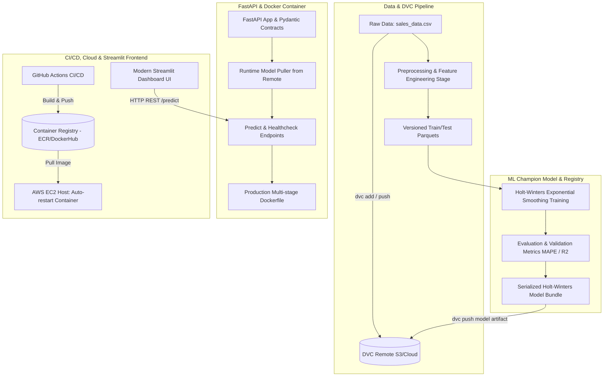

# MLOps Architecture & Team Implementation Plan: E-Commerce Demand Forecasting

## 1. Executive Summary & Vision
This document outlines the operational transition of the **Demand Forecasting Research Project** into a production-grade, reproducible, and automated **MLOps Pipeline**. 

The architecture strictly follows the system flow defined in the project blueprints:
1. **Data & Pipeline Versioning**: DVC remote storage (S3/GCS/DagsHub) tracking raw data, preprocessing, and model artifacts.
2. **Reproducible Preprocessing & Pipeline Orchestration**: Modular stages (`dvc.yaml`) for data cleaning, lag/calendar feature engineering, and temporal train-test splitting.
3. **Dedicated Model Track (Holt-Winters Champion Model)**: 
   - Based on the empirical evaluation across the Store $\times$ Product series, the **Fine-Tuned Holt-Winters Exponential Smoothing model** (with additive/multiplicative seasonality tuning on log-transformed demand) is established as our primary production champion model.
   - Devershika's scope focuses directly on modularizing, training, serializing, and registering this best model into the DVC remote registry.
4. **Model Serving & Containerization**: Lightweight FastAPI application pulling the Holt-Winters model dynamically from remote storage, packaged into Docker images and pushed to a Container Registry (ECR / Docker Hub).
5. **Continuous Integration & Deployment (CI/CD)**: GitHub Actions automating testing, image building, registry pushes, and deployment triggers.
6. **Cloud Hosting**: AWS EC2 instance running the prediction container with auto-restart policies and external client access.
7. **Interactive Frontend**: A user-friendly Streamlit web application enabling business users to explore historical trends and request real-time SKU-level demand predictions from the backend API.

---

## 2. End-to-End System Architecture



---

## 3. Team Division & Ownership (4 Members)

| Role | Domain | Assignee | Key Responsibilities |
| :--- | :--- | :--- | :--- |
| **Track 1** | Data Engineering & DVC Pipeline | **Nakshatra** | Remote DVC configuration, data versioning, modular preprocessing & feature engineering stages in `dvc.yaml`, parameter tracking (`params.yaml`). |
| **Track 2** | ML Model & Registry (Holt-Winters) | **Devershika** | Modularizing the top-performing **Holt-Winters Exponential Smoothing** model, automated evaluation (MAPE / $R^2$), serialization (`model.joblib`), and DVC model registry tracking. |
| **Track 3** | Serving Infrastructure & Containerization | **Abhav** | FastAPI inference server, dynamic runtime model loader from DVC/S3, request validation schemas, multi-stage Docker packaging. |
| **Track 4** | CI/CD, Cloud Deployment & Frontend | **Khushi** | Streamlit UI interactive dashboard, GitHub Actions CI/CD workflows (test, build, push), AWS EC2 deployment with auto-restart. |

---

## 4. Standard Interface Contracts (Cross-Team Alignment)

To allow everyone to work independently without blocking each other:

### Contract A: Pipeline Data & Model Paths (Nakshatra $\leftrightarrow$ Devershika $\leftrightarrow$ Abhav)
- **Raw Data:** `data/raw/sales_data.csv` (tracked by `data/raw/sales_data.csv.dvc`)
- **Processed Features:** `data/processed/train.parquet`, `data/processed/test.parquet`
- **Trained Artifact:** `models/holt_winters_model.joblib` (bundle containing fitted Holt-Winters forecaster, series parameters, and log-transformation metadata)
- **Metrics Output:** `reports/metrics.json`

### Contract B: Prediction API Schema (Abhav $\leftrightarrow$ Khushi)
The API is hosted on `http://<EC2-HOST>:8000`:
- **`GET /health`**: Returns `{"status": "healthy", "model": "Holt-Winters (Fine-Tuned)", "version": "v1.0.0"}`
- **`POST /predict`**:
  - **Request Body:**
    ```json
    {
      "store_id": "STORE_01",
      "product_id": "PROD_42",
      "category": "Electronics",
      "forecast_horizon_days": 14
    }
    ```
  - **Response Body:**
    ```json
    {
      "store_id": "STORE_01",
      "product_id": "PROD_42",
      "forecast": [
        {"date": "2026-11-01", "predicted_demand": 45.2},
        {"date": "2026-11-02", "predicted_demand": 42.1}
      ],
      "model_name": "Holt-Winters (Fine-Tuned)",
      "validation_mape": 0.185
    }
    ```

---

## 5. Granular GitHub Issue Backlog

### Track 1: Data Engineering & DVC Pipeline (Assignee: Nakshatra)

#### **Issue #1: Setup DVC Remote Storage & Data Versioning**
* **Assignee:** Nakshatra (`Nakshatra-05`)
* **Description:** Initialize DVC repository configuration and link it to remote cloud storage (AWS S3 bucket or Google Cloud Storage / DagsHub).
* **Acceptance Criteria:** `dvc init` executed, remote configured with credentials, `sales_data.csv` tracked with `.dvc` file, verified `dvc push` and `dvc pull` on a clean directory.

#### **Issue #2: Modularize Preprocessing & Feature Engineering into DVC Stages**
* **Assignee:** Nakshatra (`Nakshatra-05`)
* **Description:** Refactor `src/demand_forecast_engine/preprocessing` and feature engineering into clean CLI-runnable Python scripts (`preprocess.py`, `feature_engineer.py`).
* **Acceptance Criteria:** Scripts take CLI flags or `params.yaml` config, generate `data/processed/train.parquet` and `data/processed/test.parquet`, with no data leakage across time splits.

#### **Issue #3: Create `dvc.yaml` Pipeline Configuration**
* **Assignee:** Nakshatra (`Nakshatra-05`)
* **Description:** Build the `dvc.yaml` pipeline specification linking raw data $\to$ preprocessing $\to$ feature engineering.
* **Acceptance Criteria:** Running `dvc repro` executes data stages sequentially and re-runs only when input data or parameters change.

#### **Issue #4: Parameterize Data Pipeline & Add Quality Checks**
* **Assignee:** Nakshatra (`Nakshatra-05`)
* **Description:** Expose lag days, rolling windows, date cutoffs, and categorical columns in `params.yaml`. Add assertions to check for missing values or empty splits.
* **Acceptance Criteria:** Pipeline gracefully fails with clear error messages if null values occur in essential non-lag columns.

---

### Track 2: Model Training, Evaluation & Registry - Holt-Winters (Assignee: Devershika)

#### **Issue #5: Modularize Holt-Winters Exponential Smoothing Forecaster**
* **Assignee:** Devershika (`Devershika`)
* **Description:** Refactor the top-performing fine-tuned Holt-Winters Exponential Smoothing logic from `Notebooks/Holt_Winter(Expoential Smoothing).ipynb` into a production-grade module in `src/demand_forecast_engine/models/holt_winters.py`.
* **Acceptance Criteria:** Module implements standard `.fit(train_series)` and `.forecast(horizon)` methods with support for trend ('add'/'mul'), seasonal periods (7/14), and log1p demand transformation.

#### **Issue #6: Automated Evaluation & Metrics Generation**
* **Assignee:** Devershika (`Devershika`)
* **Description:** Build `evaluate.py` to test the Holt-Winters model across all Store–Product combinations, computing MAPE, RMSE, and $R^2$.
* **Acceptance Criteria:** Outputs `reports/metrics.json` containing summary statistics and Store-level evaluation tables.

#### **Issue #7: Model Serialization & Bundling**
* **Assignee:** Devershika (`Devershika`)
* **Description:** Create `save_model.py` to package the trained Holt-Winters model, seasonal parameters, and preprocessing transforms into a deployable artifact: `models/holt_winters_model.joblib`.
* **Acceptance Criteria:** Serialized artifact can be loaded independently in a clean Python session and produce forecasts without needing original training data.

#### **Issue #8: Integrate Holt-Winters Stage into DVC & Push to Remote Registry**
* **Assignee:** Devershika (`Devershika`)
* **Description:** Add training and evaluation stages to `dvc.yaml` and configure DVC tracking on `models/holt_winters_model.joblib`.
* **Acceptance Criteria:** `dvc repro` trains and packages the model, and `dvc push` uploads the model bundle to the remote storage registry.

---

### Track 3: Serving Infrastructure & Containerization (Assignee: Abhav)

#### **Issue #9: Design FastAPI Prediction Service & Request Validation**
* **Assignee:** Abhav
* **Description:** Set up the FastAPI framework with Pydantic request/response schemas matching Contract B.
* **Acceptance Criteria:** Endpoint `/predict` validates payload types, handles bad inputs with HTTP 422, and returns mock predictions when model is not yet loaded.

#### **Issue #10: Dynamic Model Loader from DVC Remote / S3**
* **Assignee:** Abhav
* **Description:** Implement `src/api/loader.py` to fetch `holt_winters_model.joblib` from remote storage (S3/DVC remote) during application startup or fallback to local volume mount.
* **Acceptance Criteria:** Server boots up, downloads the artifact if not cached locally, loads it into memory, and exposes `/health` with model metadata.

#### **Issue #11: Implement End-to-End Inference Logic**
* **Assignee:** Abhav
* **Description:** Connect the loaded Holt-Winters model bundle to the `/predict` route to generate the requested day-ahead demand predictions.
* **Acceptance Criteria:** Verified with unit tests asserting valid forecast numbers returned for given Store ID, Product ID, and horizon.

#### **Issue #12: Dockerize FastAPI Service with Production ASGI**
* **Assignee:** Abhav
* **Description:** Create an optimized multi-stage `Dockerfile` running Uvicorn/Gunicorn with non-root security.
* **Acceptance Criteria:** Container builds cleanly, runs locally on `docker run -p 8000:8000`, passes `/health` and responds to `/predict`.

---

### Track 4: CI/CD, Cloud Deployment & Frontend (Assignee: Khushi)

#### **Issue #13: Build Interactive Streamlit Frontend**
* **Assignee:** Khushi (`khushik8605`)
* **Description:** Overhaul `apps/frontend_v01.py` into a modern UI (`apps/app.py`). Connect the UI to the FastAPI `/predict` endpoint, allowing users to select SKU, date ranges, and view historical sales + forecasted demand in interactive Plotly charts.
* **Acceptance Criteria:** Clean UI with error toasts for backend downtime, interactive filters, responsive layout, and visual forecast curves.

#### **Issue #14: Setup GitHub Actions CI Pipeline (Lint & Test)**
* **Assignee:** Khushi (`khushik8605`)
* **Description:** Create `.github/workflows/ci.yaml` to trigger on pull requests, run `flake8`/`black`, execute `pytest` on core modules and API routes.
* **Acceptance Criteria:** PR status checks enforce passing unit tests before merge.

#### **Issue #15: Setup GitHub Actions CD Pipeline (Docker Registry Build & Push)**
* **Assignee:** Khushi (`khushik8605`)
* **Description:** Create `.github/workflows/cd.yaml` that builds the Docker image on merge to `main`, tags it with the Git commit SHA, and pushes to AWS ECR or Docker Hub.
* **Acceptance Criteria:** Pushing a commit to `main` results in a new image tag appearing in the container registry.

#### **Issue #16: AWS EC2 Provisioning, Deployment Script & Auto-Restart Policy**
* **Assignee:** Khushi (`khushik8605`)
* **Description:** Configure an AWS EC2 instance (Ubuntu, Docker, AWS CLI/IAM roles for S3/ECR pull). Write deployment script / `docker-compose.prod.yml` with `restart: always` to ensure uptime.
* **Acceptance Criteria:** Deployment trigger pulls the latest image, launches the container with auto-restart enabled, and Streamlit frontend connects successfully to the public IP.
