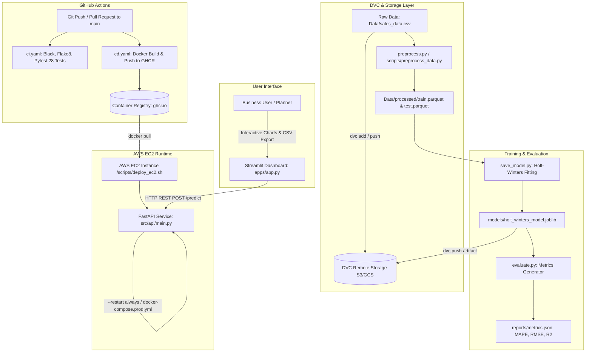

# E-Commerce Demand Forecasting MLOps: Architecture, File Inventory & Implementation Guide

## 1. System Overview & Architecture Workflow

This repository implements a production-grade, reproducible **MLOps pipeline** for multi-store SKU-level demand forecasting. The architecture transitions research code (originally exploring Linear Regression, ARIMA, Prophet, and XGBoost) into an automated, containerized system using **Holt-Winters Exponential Smoothing** as the production champion model.



---

## 2. Team Track Ownership & Responsibility Matrix

| Track | Domain | Assigned Owner | Primary Deliverables | Files Maintained |
| :--- | :--- | :--- | :--- | :--- |
| **Track 1** | Data Pipeline & DVC Versioning | **Nakshatra** | Remote DVC storage, data validation, temporal train-test splits, pipeline reproducibility. | `dvc.yaml`, `params.yaml`, `preprocess.py`, `feature_engineer.py`, `src/demand_forecast_engine/preprocessing/`, `tests/test_validation.py` |
| **Track 2** | ML Model & Registry | **Devershika** | Modularizing Holt-Winters champion model, serialization, model metrics, evaluation suite. | `save_model.py`, `evaluate.py`, `src/demand_forecast_engine/models/holt_winters.py`, `models/`, `reports/metrics.json`, `tests/test_holt_winters.py` |
| **Track 3** | Serving Infrastructure & Docker | **Abhav** | FastAPI REST prediction microservice, input validation, Dockerfile, local docker-compose. | `src/api/main.py`, `src/api/__init__.py`, `Dockerfile`, `docker-compose.yml`, `tests/test_api.py` |
| **Track 4** | CI/CD, EC2 Cloud & Frontend | **Khushi** | Streamlit UI dashboard, GitHub Actions CI/CD workflows, EC2 deployment script & keep-alive policies. | `apps/app.py`, `.github/workflows/ci.yaml`, `.github/workflows/cd.yaml`, `scripts/deploy_ec2.sh`, `docker-compose.prod.yml`, `tests/test_frontend.py` |

---

## 3. Comprehensive File Inventory & Roles

### 3.1 Pipeline Orchestration & Configuration
* **[`dvc.yaml`](file:///c:/Users/ad51328/Projects/E-Commerce-MLOPs/dvc.yaml)**: Defines reproducible pipeline stages (`preprocess`, `train`, `evaluate`), mapping input dependencies, tracked parameters, and outputs.
* **[`dvc.lock`](file:///c:/Users/ad51328/Projects/E-Commerce-MLOPs/dvc.lock)**: Immutable record of data hashes, code versions, and artifact checkpoints generated by `dvc repro`.
* **[`params.yaml`](file:///c:/Users/ad51328/Projects/E-Commerce-MLOPs/params.yaml)**: Central configuration file controlling data paths, input schema, split ratio (`test_ratio: 0.2`), lag definitions, and Holt-Winters hyper-parameters (`trend: add`, `seasonal: add`, `seasonal_periods: 7`).
* **[`pyproject.toml`](file:///c:/Users/ad51328/Projects/E-Commerce-MLOPs/pyproject.toml)**: Project build specifications, package setup for `demand_forecast_engine`, dependencies (`statsmodels`, `joblib`, `fastapi`, `streamlit`, `plotly`), and pytest configuration.
* **[`requirements.txt`](file:///c:/Users/ad51328/Projects/E-Commerce-MLOPs/requirements.txt)**: Direct pip requirements for local virtual environments and Docker builders.

### 3.2 Preprocessing & Feature Engineering
* **[`preprocess.py`](file:///c:/Users/ad51328/Projects/E-Commerce-MLOPs/preprocess.py)**: CLI entrypoint validating raw data schema, missing values, date format (`%d-%m-%Y`), forward-filling demand, and creating `Demand_log1p`.
* **[`feature_engineer.py`](file:///c:/Users/ad51328/Projects/E-Commerce-MLOPs/feature_engineer.py)**: CLI script generating lag and rolling window features strictly bounded by time splits without data leakage.
* **[`scripts/preprocess_data.py`](file:///c:/Users/ad51328/Projects/E-Commerce-MLOPs/scripts/preprocess_data.py)**: Integrated DVC runner reading raw CSV and writing `Data/processed/train.parquet` and `test.parquet`.
* **[`src/demand_forecast_engine/preprocessing/clean.py`](file:///c:/Users/ad51328/Projects/E-Commerce-MLOPs/src/demand_forecast_engine/preprocessing/clean.py)**: Cleaning routines handling group-level forward fills and outlier clipping.
* **[`src/demand_forecast_engine/preprocessing/validate.py`](file:///c:/Users/ad51328/Projects/E-Commerce-MLOPs/src/demand_forecast_engine/preprocessing/validate.py)**: Defensive assertions checking missing columns, date continuity, and positive quantity rules.
* **[`src/demand_forecast_engine/feature_engineering/features.py`](file:///c:/Users/ad51328/Projects/E-Commerce-MLOPs/src/demand_forecast_engine/feature_engineering/features.py)**: Lag generators, calendar indicators (dayofweek, month, is_weekend), and categorical encoder logic.

### 3.3 Model Training, Evaluation & Registry
* **[`src/demand_forecast_engine/models/holt_winters.py`](file:///c:/Users/ad51328/Projects/E-Commerce-MLOPs/src/demand_forecast_engine/models/holt_winters.py)**: The champion model module defining `HoltWintersForecaster` and `load_holt_winters_model()` supporting `fit()`, `forecast()`, and `save()`.
* **[`save_model.py`](file:///c:/Users/ad51328/Projects/E-Commerce-MLOPs/save_model.py)**: CLI wrapper training the model on `Data/processed/train.parquet` and serializing it into `models/holt_winters_model.joblib`.
* **[`evaluate.py`](file:///c:/Users/ad51328/Projects/E-Commerce-MLOPs/evaluate.py)**: Reads `test.parquet`, runs inference across Store–Product groups, computes MAPE / RMSE / $R^2$, and writes structured metrics to `reports/metrics.json`.
* **[`models/holt_winters_model.joblib`](file:///c:/Users/ad51328/Projects/E-Commerce-MLOPs/models/holt_winters_model.joblib)**: Serialized model bundle artifact ready for production deployment.
* **[`reports/metrics.json`](file:///c:/Users/ad51328/Projects/E-Commerce-MLOPs/reports/metrics.json)**: Detailed model validation metrics report tracked in DVC.

### 3.4 Serving & Containerization
* **[`src/api/main.py`](file:///c:/Users/ad51328/Projects/E-Commerce-MLOPs/src/api/main.py)**: FastAPI microservice exposing:
  - `GET /health`: Healthcheck, model load status, and version info.
  - `POST /predict`: Accepts `store_id`, `product_id`, and `forecast_horizon_days`, returning day-by-day projected demand. Includes resilient cross-version deserialization fallback.
* **[`Dockerfile`](file:///c:/Users/ad51328/Projects/E-Commerce-MLOPs/Dockerfile)**: Multi-stage container build (Python 3.11-slim) running non-root `appuser` with container healthchecks.
* **[`docker-compose.yml`](file:///c:/Users/ad51328/Projects/E-Commerce-MLOPs/docker-compose.yml)**: Local container composition.
* **[`docker-compose.prod.yml`](file:///c:/Users/ad51328/Projects/E-Commerce-MLOPs/docker-compose.prod.yml)**: Production composition with `restart: always` and 10MB log rotation.

### 3.5 Frontend User Interface
* **[`apps/app.py`](file:///c:/Users/ad51328/Projects/E-Commerce-MLOPs/apps/app.py)**: Interactive Streamlit web application:
  - Connects to backend `http://localhost:8000/predict` (with local mock fallback if offline).
  - Loads data dynamically from `Data/processed/*.parquet` or fallback CSV.
  - Renders KPI metric cards, Plotly forecast curves with $\pm 12\%$ uncertainty bands, safety stock recommendations, and CSV download.

### 3.6 CI/CD & Deployment
* **[`.github/workflows/ci.yaml`](file:///c:/Users/ad51328/Projects/E-Commerce-MLOPs/.github/workflows/ci.yaml)**: Triggers on PRs and pushes to `main`. Runs code checks with `black`, `flake8`, and executes all 28 `pytest` tests on Python 3.10 and 3.11.
* **[`.github/workflows/cd.yaml`](file:///c:/Users/ad51328/Projects/E-Commerce-MLOPs/.github/workflows/cd.yaml)**: Triggers on merge to `main`. Builds Docker image and publishes it to GitHub Container Registry (`ghcr.io/devershika/e-commerce-mlops/demand-forecast-api:latest`).
* **[`scripts/deploy_ec2.sh`](file:///c:/Users/ad51328/Projects/E-Commerce-MLOPs/scripts/deploy_ec2.sh)**: Shell script for AWS EC2 instances that auto-installs Docker, pulls the latest image, starts the container with `--restart always`, and validates `/health`.
* **[`docs/EC2_DEPLOYMENT_GUIDE.md`](file:///c:/Users/ad51328/Projects/E-Commerce-MLOPs/docs/EC2_DEPLOYMENT_GUIDE.md)**: Cloud provisioning guide with security group rules and testing steps.

---

## 4. Master Execution Script (`scripts/run_pipeline.py`)

To run, reproduce, test, or launch any portion of this project from a single command, use the unified pipeline runner script:

```bash
# Display all available options
python scripts/run_pipeline.py --help

# Run all automated tests
python scripts/run_pipeline.py --test

# Run DVC data preprocessing and training pipeline
python scripts/run_pipeline.py --pipeline

# Start the FastAPI prediction microservice
python scripts/run_pipeline.py --serve

# Start the Streamlit frontend dashboard
python scripts/run_pipeline.py --ui

# Run full end-to-end flow (DVC + Tests + Serving + UI)
python scripts/run_pipeline.py --all
```
